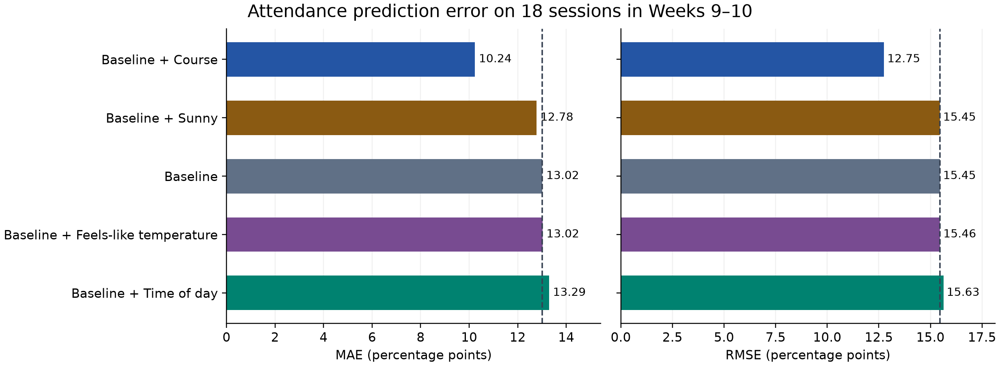
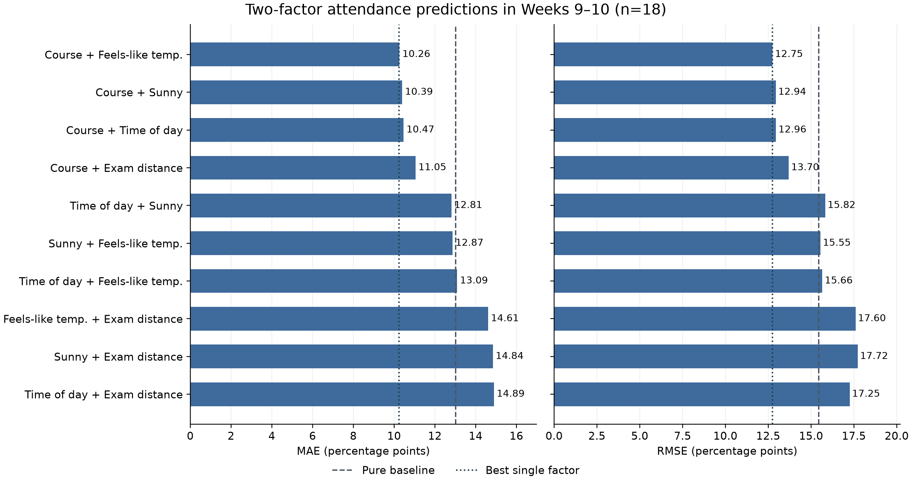
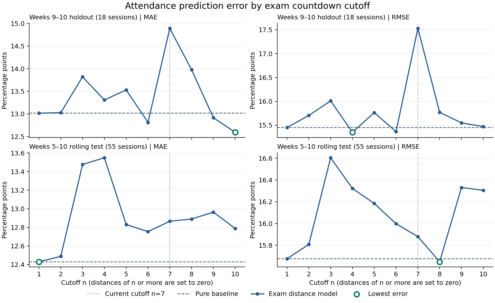

# Course Attendance Modeling Retrospective

*COMP0212 Modeling and Simulation  ·  22 November 2026*

The shared ODE with a course adjustment had the lowest error on the 18 sessions held out in Weeks 9–10. Its MAE was 10.238 percentage points versus 13.016 for the pure baseline. The best pair, course and feels-like temperature, reached 10.264. In the sweep of exam cutoffs from 1 to 10, the pure baseline still had the lowest rolling-test MAE.

## Stage Objectives and Outputs

| Stage | Objective and output |
| :--- | :--- |
| Data preparation | Use one row per session, retain attendance counts and match weather at the start time. |
| Baseline | Refit the existing ODE on the cleaned first eight teaching weeks and freeze the curve. |
| Single factors | Fit five individual factors and compare gains on the same holdout. |
| Factor pairs | Fit all ten additive pairs jointly and export weights, error tables and session plots. |
| Exam cutoff sensitivity | Refit the single exam factor at cutoffs from 1 to 10 and compare fixed and rolling test errors. |

## Data Cleaning and Time Split

The inputs contain 100 card-tap attendance records across four courses. Initial cleaning removed four Math 2 entries labeled Assessment, two each on 30 January and 27 February. The supplied exam timetable then prompted removal of two Math 2 tutorials at 12:00–14:00 on 13 February and 6 March. The morning lectures remained. The 27 February assessment label differs from the supplied timetable, which governs the countdown.

The 94 retained sessions run from 12 January to 26 March 2026. Weeks 1–8 supply 76 training sessions and Weeks 9–10 supply 18 holdout sessions. The target is the number of recorded card taps divided by the eligible count, which is 58 for every retained session. Teaching-week numbering skips Reading Week.

## English Data Fields

| Field | Meaning |
| :--- | :--- |
| course_date | London local session date in ISO format. |
| morning, afternoon | Complementary indicators. Afternoon starts at 12:00. |
| sunny | 1 for a start-time weather code of 0 or 1. |
| feels_like_temperature_c | Matched feels-like temperature at session start in °C. |
| COMP0206–COMP0209 | Four one-hot columns for Math 2, Electronics, Control 1 and DSA. |
| classes_until_exam | Uses the default cutoff n=7. Keeps counts from 1 to 6 and uses 0 for counts of 7 or more. |

## Model Definition and Parameter Estimation

### Shared Weekly Baseline

Both original weather scripts fit the same ODE first. Let t be the teaching week minus one. For each of the first eight weeks, pool recorded counts and eligible counts across courses. Fit the eight resulting proportions by bounded nonlinear least squares.

```math
\frac{dA}{dt}=-k(A-A_{\mathrm{eq}}),\qquad A(t)=A_{\mathrm{eq}}+(A_0-A_{\mathrm{eq}})e^{-kt}
```

Removing the two exam overlaps reduced the training set from 78 to 76 sessions. Refitting by the original method gives A₀ = 0.808843, Aeq = 0.282960 and k = 0.196729. Every factor model in the fixed split shares this curve.

### Factor Adjustments and Objective

For session i, use the log odds of A(tᵢ) as a fixed offset. S is the subset of factors and gⱼ is one factor adjustment. Fit the adjustments to the training attendance count aᵢ and eligible count Nᵢ by minimizing binomial negative log likelihood. The code clips the baseline to [10⁻⁶, 1−10⁻⁶] before taking its logit.

```math
\eta_i=\mathrm{logit}(A(t_i))+\sum_{j\in S}g_j(x_{ij}),\qquad p_i=\frac{1}{1+e^{-\eta_i}}
```

```math
\mathcal L=\sum_{i\in\mathrm{train}}\bigl[N_i\log(1+e^{\eta_i})-a_i\eta_i\bigr]
```

The course term is βᵀCᵢ, where Cᵢ is a four-element one-hot vector. Time of day and sunny status each use two category offsets. Temperature uses a linear adjustment centered at the training mean of 6.7145 °C. Pairs add their two terms and re-estimate the weights jointly. When both factors span a constant, the second uses a zero reference coefficient and the first absorbs the shared intercept.

### Exam Countdown Across Courses

DSA exams are on 29 January, 12 February, 5 March and 19 March. Math 2 exams are on 30 January, 13 February, 6 March and 27 March. All use a noon boundary. Count from the current session through the last retained session before the next scheduled exam, across courses. The last session before an exam is 1. Let `d` be the remaining class count before applying the cutoff. A cutoff `n` keeps countdowns satisfying 1 ≤ d ≤ n−1 and sets both the feature and the exam adjustment to zero when d ≥ n.

```math
g_{\mathrm{exam},n}(d)=I_n(d)\left[\alpha_n+\beta_n(d-\bar{d}_n)\right]
```

Here Iₙ(d) is 1 when 1 ≤ d ≤ n−1 and 0 otherwise.

The mean d̄ₙ uses training sessions inside that cutoff's window. The main experiment uses `n=7`, which gives 36 rows from 1 to 6 and 58 zeros. The exam-only adjustment uses the 24 training sessions inside that window, with d̄₇ = 3. Pairs fit jointly on all 76 training sessions. Outside the window the exam term is zero and the other factor still applies.

The cutoff sweep tests exam distance alone. It refits the adjustment separately for each `n` and training window while using the same shared ODE for a given split. At `n=1`, no sessions activate the exam term, so predictions come directly from the pure baseline. At `n=2`, only sessions with `d=1` are in the window. The model fits a constant adjustment and sets the slope to zero.

## Fixed Holdout Results

Tables 1 and 2 use the same 18 sessions. Models that include exam distance use the default cutoff `n=7`. Compare each predicted probability with the observed attendance rate and express the error in percentage points. MAE is the mean absolute error. RMSE is the square root of the mean squared error. Rankings use MAE, and lower is better for both.

### Baseline and Single Factors

| Model | MAE | RMSE |
| :--- | ---: | ---: |
| Baseline + Course | 10.238 | 12.750 |
| Baseline + Sunny | 12.780 | 15.453 |
| Pure baseline | 13.016 | 15.452 |
| Baseline + Feels-like temperature | 13.021 | 15.463 |
| Baseline + Time of day | 13.292 | 15.627 |
| Baseline + Exam distance | 14.893 | 17.531 |

*Table 1. Single-factor holdout errors in percentage points. See Figure 1.*

### Factor Pairs

| Model | MAE | RMSE |
| :--- | ---: | ---: |
| Course + Feels-like temperature | 10.264 | 12.754 |
| Course + Sunny | 10.394 | 12.941 |
| Course + Time of day | 10.466 | 12.956 |
| Course + Exam distance | 11.051 | 13.699 |
| Time of day + Sunny | 12.813 | 15.823 |
| Sunny + Feels-like temperature | 12.874 | 15.549 |
| Time of day + Feels-like temperature | 13.091 | 15.658 |
| Feels-like temperature + Exam distance | 14.611 | 17.597 |
| Sunny + Exam distance | 14.841 | 17.720 |
| Time of day + Exam distance | 14.893 | 17.252 |

*Table 2. Holdout errors for all ten pairs in percentage points. Each pair uses the pure ODE as its baseline. See Figure 2.*

Course is the only single factor that improves both error measures. Course plus feels-like temperature is the best pair, with MAE 0.026 percentage points above course alone. Each of the ten pairs has higher errors than the better of its two individual factors.

## Error Figures and Rolling Check

Figure 1 shows the original four single factors against the pure baseline. The exam result is reported in Table 1 and [figures/exam_distance_holdout_errors.png](../figures/exam_distance_holdout_errors.png). Figure 2 marks both the pure baseline and the best single factor, making the gain from adding a second factor easy to assess.



*Figure 1. Single-factor holdout errors. The dashed line marks the pure baseline. Source: [figures/single_factor_holdout_errors.png](../figures/single_factor_holdout_errors.png).*



*Figure 2. Pair errors. Dots mark the best single factor and dashes mark the pure baseline. Source: [figures/factor_pair_holdout_errors.png](../figures/factor_pair_holdout_errors.png).*

The exam check uses an expanding window starting in Week 5, with each week predicted from earlier weeks only. Across 55 sessions, adding exam distance at the default cutoff `n=7` raises MAE from 12.430 to 12.866 and RMSE from 15.676 to 15.880. The results CSV also reports a constant adjustment for the same window. The common ranking uses the fixed holdout.

## Exam Cutoff Sensitivity

Table 3 compares ten cutoffs. The fixed holdout contains 18 sessions from Weeks 9–10, and the rolling test contains 55 sessions from Weeks 5–10. Each cutoff is scored on the full test set for that protocol, including sessions outside the exam window that use the pure baseline.

| Cutoff n | Holdout sessions in window | Holdout MAE | Holdout RMSE | Rolling MAE | Rolling RMSE |
| ---: | ---: | ---: | ---: | ---: | ---: |
| 1 (pure baseline) | 0 | 13.016 | 15.452 | **12.430** | 15.676 |
| 2 | 2 | 13.028 | 15.704 | 12.489 | 15.808 |
| 3 | 4 | 13.819 | 16.011 | 13.477 | 16.604 |
| 4 | 6 | 13.307 | **15.350** | 13.549 | 16.322 |
| 5 | 8 | 13.530 | 15.764 | 12.831 | 16.184 |
| 6 | 10 | 12.811 | 15.365 | 12.754 | 15.998 |
| 7 (default) | 12 | 14.893 | 17.531 | 12.866 | 15.880 |
| 8 | 14 | 13.976 | 15.770 | 12.890 | **15.649** |
| 9 | 15 | 12.914 | 15.548 | 12.964 | 16.331 |
| 10 | 16 | **12.592** | 15.470 | 12.787 | 16.306 |

*Table 3. Exam cutoff errors in percentage points. The lowest error in each column is bold. Source: [exam_threshold_scores.csv](../figures/exam_threshold_scores.csv).*



*Figure 3. Cutoff sensitivity. The horizontal dashed line marks the pure baseline, the vertical dotted line marks the default n=7, and the open circle marks the lowest error in each panel.*

On the fixed holdout, `n=10` has the lowest MAE and `n=4` has the lowest RMSE. Only `n=6` improves both holdout metrics over the pure baseline, and both metrics then worsen in the rolling test. Every cutoff that activates the exam adjustment raises rolling MAE. At `n=8`, rolling RMSE is about 0.028 percentage points lower, while MAE rises. The two tests provide no consistent improvement from an exam cutoff.

## Implementation and Reproduction

| Location | Responsibility |
| :--- | :--- |
| [RAI_attendance_with_weather.csv](../RAI_attendance_with_weather.csv) | Cleaned sessions, observed counts, teaching weeks and matched start-time weather. |
| [data/combined_courses.csv](../data/combined_courses.csv) | 94 rows of English-named features. Per-course exports are in [data/COMP0206.csv](../data/COMP0206.csv) through [COMP0209.csv](../data/COMP0209.csv). |
| [compare_single_factors.py](../compare_single_factors.py) | Reconciles session inputs, fits the weekly ODE, builds designs and fits adjustments by BFGS with an analytic gradient. |
| [compare_exam_distance.py](../compare_exam_distance.py) | Computes and caps the countdown, updates the combined CSV and runs fixed and rolling tests. |
| [compare_factor_pairs.py](../compare_factor_pairs.py) | Reuses the feature definitions and fitter, fits ten pairs and exports all model weights and prediction figures. |
| [sweep_exam_thresholds.py](../sweep_exam_thresholds.py) | Reuses the countdown and fitter, tests each cutoff in memory, and writes a separate results table and figure. |

The combined features are reconciled against the attendance source at session level, retaining distinct classes on the same date. Fitting uses the source with class IDs and observed counts. Before fitting, the code checks unique IDs, valid counts, matched weather timestamps and feature values. The pair script also reconciles the exported exam distance.

### Commands and Outputs

Run from the simulation_Y2_T1 project root using the supplied clean source CSV and data directory. The verified environment used Python 3.11.3. Run the first command if the dependencies are missing.

```powershell
python -m pip install numpy==1.24.3 pandas==1.5.3 scipy==1.10.1 matplotlib==3.7.1
python compare_single_factors.py
python compare_exam_distance.py
python compare_factor_pairs.py
python sweep_exam_thresholds.py
```

In figures/, [single_factor_scores.csv](../figures/single_factor_scores.csv), [exam_distance_scores.csv](../figures/exam_distance_scores.csv) and [factor_pair_scores.csv](../figures/factor_pair_scores.csv) cover the main experiment. [factor_model_weights.json](../figures/factor_model_weights.json) stores its three baseline parameters, weights for five single factors and ten pairs, and the centering and reference conventions. The cutoff sweep writes [exam_threshold_scores.csv](../figures/exam_threshold_scores.csv) and [exam_threshold_errors.png](../figures/exam_threshold_errors.png). The combined feature table and main experiment weights use the default cutoff `n=7`.

The session plots are [figures/single_factor_all_holdout_predictions.png](../figures/single_factor_all_holdout_predictions.png) and [figures/factor_pair_holdout_predictions.png](../figures/factor_pair_holdout_predictions.png). Black points show observations, colored lines join successive session predictions, and gray vertical segments indicate individual errors.

### Limits of Interpretation

The holdout contains 18 sessions and is shared across candidate models and cutoffs, so the ranking is specific to this dataset. A cutoff selected from this comparison would need validation on new sessions. Course and scheduling can be associated. For example, all Electronics sessions start in the afternoon. Weather is a gridded estimate near campus at session start, and the target is card-tap attendance. Causal interpretation requires further data and validation.
