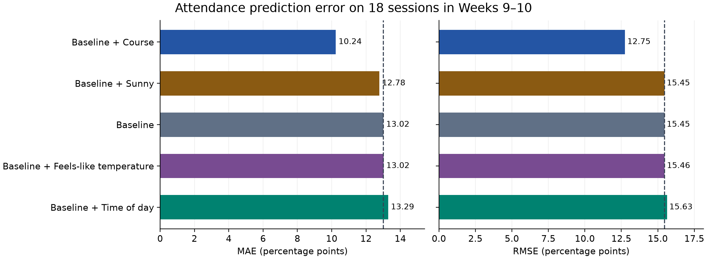
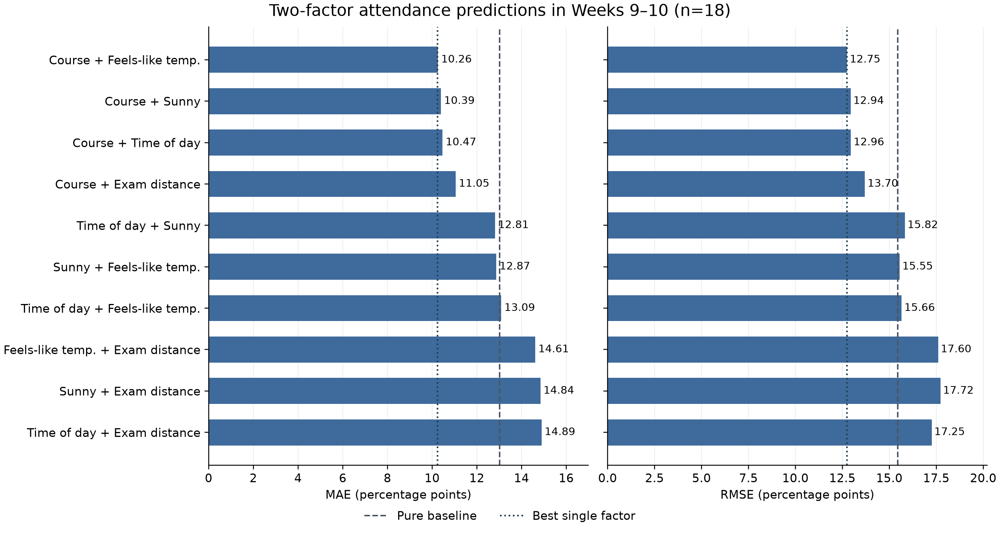
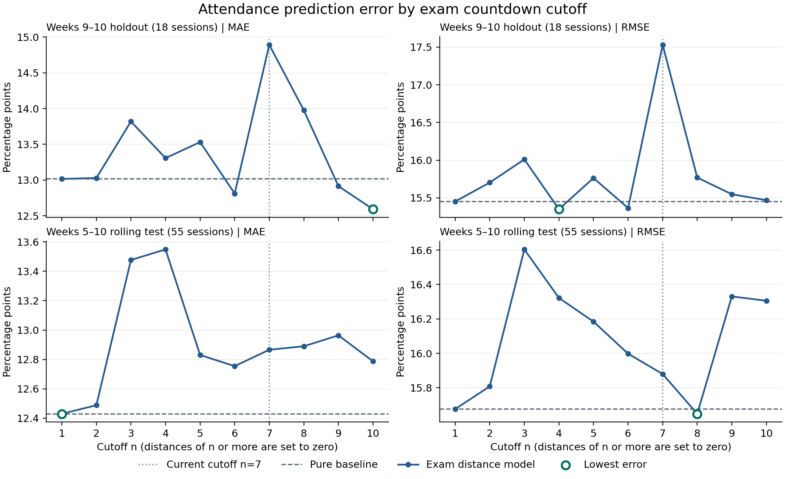

# 课程出勤率模型技术复盘

*COMP0212 建模与仿真  ·  2026 年 11 月 22 日*

在第 9–10 教学周的 18 节测试课上，共享 ODE 加科目修正的模型误差最低，MAE 为 10.238 个百分点，纯基线为 13.016。最好的双因素模型加入了科目和体感温度，MAE 为 10.264。考试阈值从 1 到 10 的扫描中，逐周测试的最低 MAE 仍来自纯基线。

## 阶段目标与交付

| 阶段 | 目标与交付 |
| :--- | :--- |
| 数据准备 | 统一课次粒度，保留出勤人数和应到人数并匹配开课天气。 |
| 基线 | 复用项目原有 ODE 形式，在清洗后的前八周重估并固定曲线。 |
| 单因素 | 依次拟合五个因素，用同一批留出数据衡量增益。 |
| 双因素 | 联合拟合全部十种加法组合，导出权重、误差表和逐节预测图。 |
| 考试阈值敏感性 | 逐一拟合 1–10 节的截断阈值，比较固定留出与逐周测试结果。 |

## 数据清洗与训练划分

四门科目共有 100 条原始刷卡记录。原清洗去掉 Math 2 的 4 条 Assessment（1 月 30 日和 2 月 27 日各两条），随后按提供的考试日程剔除 2 月 13 日和 3 月 6 日两条 12:00–14:00 的 Math 2 Tutorial。两天上午的 Lecture 保留。2 月 27 日的 Assessment 标签与给定考试日程存在差异，倒数使用给定日程。

最终为 94 节课，日期范围 2026 年 1 月 12 日至 3 月 26 日。第 1–8 教学周共 76 节用于拟合，第 9–10 周共 18 节用于留出评估。课次目标为刷卡出勤人数除以应到人数，所有课次的应到人数均为 58。教学周编号跳过阅读周。

## 英文数据字段

| 字段 | 含义 |
| :--- | :--- |
| course_date | 伦敦当地开课日期，ISO 格式。 |
| morning, afternoon | 互补的 0/1 标记，12:00 起算下午。 |
| sunny | 开课天气代码为 0 或 1 时取 1。 |
| feels_like_temperature_c | 开课时匹配的体感温度，摄氏度。 |
| COMP0206–COMP0209 | Math 2、Electronics、Control 1、DSA 的四列 one-hot。 |
| classes_until_exam | 数据表采用默认阈值 n=7。考前剩余 1–6 节保留倒数，剩余 7 节及以上记 0。 |

## 模型定义与参数估计

### 四门课共享的周基线

原始降雨和恶劣天气脚本均先拟合相同的 ODE。令 t 为教学周编号减 1。对前八周，按周汇总出勤人次和应到人次，得到八个比例，再以有界非线性最小二乘拟合 A₀、Aeq 和 k。

```math
\frac{dA}{dt}=-k(A-A_{\mathrm{eq}}),\qquad A(t)=A_{\mathrm{eq}}+(A_0-A_{\mathrm{eq}})e^{-kt}
```

移除两条考试重叠记录后，训练课次由 78 减为 76。采用原方法重估得到 A₀ = 0.808843、Aeq = 0.282960、k = 0.196729。所有固定划分的模型共用这条曲线。

### 因素修正与优化目标

对课次 i，以 A(tᵢ) 的对数几率为固定偏置。S 为选定的因素集合，gⱼ 为一个因素的修正。用训练集逐节出勤人数 aᵢ 和应到人数 Nᵢ 拟合修正项，最小化二项负对数似然。代码对转换 logit 前的基线概率限制到 [10⁻⁶, 1−10⁻⁶]。

```math
\eta_i=\mathrm{logit}(A(t_i))+\sum_{j\in S}g_j(x_{ij}),\qquad p_i=\frac{1}{1+e^{-\eta_i}}
```

```math
\mathcal L=\sum_{i\in\mathrm{train}}\bigl[N_i\log(1+e^{\eta_i})-a_i\eta_i\bigr]
```

科目项为 βᵀCᵢ，其中 Cᵢ 为四维 one-hot 向量。时段和晴天分别为两类常数修正。体感温度使用训练均值 6.7145 °C 居中的线性修正。双因素模型把两项修正相加并重新联合估计权重。若两个因素都包含常数，第二项采用零参考系数，公共常数由第一项表示。

### 全科目考试倒数

DSA 考试日期为 1 月 29 日、2 月 12 日、3 月 5 日、3 月 19 日。Math 2 为 1 月 30 日、2 月 13 日、3 月 6 日、3 月 27 日。全部按当天 12:00 排序。每节课从当前课次起，计算到下一场任意科目考试前的保留课次数，最后一节为 1。下式中，`d` 为截断前的剩余课数。阈值 `n` 只保留 1 ≤ d ≤ n−1 的倒数，d ≥ n 时特征和修正均为 0。

```math
g_{\mathrm{exam},n}(d)=I_n(d)\left[\alpha_n+\beta_n(d-\bar{d}_n)\right]
```

其中，若 1 ≤ d ≤ n−1，则 Iₙ(d) 为 1，否则为 0。

d̄ₙ 由该阈值下窗口内的训练课计算。主实验采用 `n=7`，全表有 36 节取 1–6，58 节取 0。考试单因素用窗口内 24 节训练课估计修正，d̄₇ = 3。双因素模型在全部 76 节课上联合拟合，窗口外的考试项为 0，另一因素照常生效。

阈值扫描仅测试考试距离单因素。对每个 `n` 和训练窗口分别重新估计修正，保留同一训练窗口对应的共享 ODE。`n=1` 时没有课次启用考试修正，直接得到纯基线。`n=2` 时窗口内只剩 `d=1`，仅估计常数修正，斜率为 0。

## 固定留出集结果

表 1 和表 2 以同一批 18 节课为比较对象，涉及考试距离的模型采用默认阈值 `n=7`。将每节课的预测概率与刷卡出勤率相减，再将误差换算为百分点。MAE 为绝对误差的均值，RMSE 为平方误差均值的平方根。模型按 MAE 排序，两项均越低越好。

### 基线与单因素比较

| 模型 | MAE | RMSE |
| :--- | ---: | ---: |
| 基线 + 科目 | 10.238 | 12.750 |
| 基线 + 晴天 | 12.780 | 15.453 |
| 纯基线 | 13.016 | 15.452 |
| 基线 + 体感温度 | 13.021 | 15.463 |
| 基线 + 上午或下午 | 13.292 | 15.627 |
| 基线 + 考前剩余课次 | 14.893 | 17.531 |

*表 1  单因素留出集误差（百分点）。比较见图 1。*

### 双因素比较

| 模型 | MAE | RMSE |
| :--- | ---: | ---: |
| 科目 + 体感温度 | 10.264 | 12.754 |
| 科目 + 晴天 | 10.394 | 12.941 |
| 科目 + 上午或下午 | 10.466 | 12.956 |
| 科目 + 考前剩余课次 | 11.051 | 13.699 |
| 上午或下午 + 晴天 | 12.813 | 15.823 |
| 晴天 + 体感温度 | 12.874 | 15.549 |
| 上午或下午 + 体感温度 | 13.091 | 15.658 |
| 体感温度 + 考前剩余课次 | 14.611 | 17.597 |
| 晴天 + 考前剩余课次 | 14.841 | 17.720 |
| 上午或下午 + 考前剩余课次 | 14.893 | 17.252 |

*表 2  十个双因素模型的留出集误差（百分点）。各模型均以纯 ODE 为基础。比较见图 2。*

科目是唯一同时改善 MAE 和 RMSE 的单因素。科目加体感温度是最好的双因素，但 MAE 比只加科目高 0.026 个百分点。十个组合的两项误差均高于该组合中表现更好的单因素。

## 误差图与逐周检验

图 1 展示四个非考试单因素与纯基线的误差。考试距离结果见表 1 和 [figures/exam_distance_holdout_errors.png](../figures/exam_distance_holdout_errors.png)。图 2 用竖线标出纯基线与最优单因素，便于比较双因素误差。



*图 1  单因素模型与纯基线的留出集误差。虚线为纯基线。来源：[figures/single_factor_holdout_errors.png](../figures/single_factor_holdout_errors.png)。*



*图 2  双因素模型误差。点线为最优单因素，虚线为纯基线。来源：[figures/factor_pair_holdout_errors.png](../figures/factor_pair_holdout_errors.png)。*

对考试距离另做扩展窗口测试。从第 5 周开始，仅用此前教学周训练并预测当周。合计 55 节课，默认阈值 `n=7` 使 MAE 从 12.430 升到 12.866，RMSE 从 15.676 升到 15.880。同一窗口的常数修正也记录在结果表中，统一排名使用固定留出集。

## 考试阈值敏感性

表 3 对照了 10 个阈值。固定留出使用第 9–10 周的 18 节课，逐周测试使用第 5–10 周的 55 节课。各阈值都在各自的完整测试集上评分，包括按规则使用纯基线的窗口外课次。

| 阈值 n | 固定留出启用课次 | 固定留出 MAE | 固定留出 RMSE | 逐周 MAE | 逐周 RMSE |
| ---: | ---: | ---: | ---: | ---: | ---: |
| 1（纯基线） | 0 | 13.016 | 15.452 | **12.430** | 15.676 |
| 2 | 2 | 13.028 | 15.704 | 12.489 | 15.808 |
| 3 | 4 | 13.819 | 16.011 | 13.477 | 16.604 |
| 4 | 6 | 13.307 | **15.350** | 13.549 | 16.322 |
| 5 | 8 | 13.530 | 15.764 | 12.831 | 16.184 |
| 6 | 10 | 12.811 | 15.365 | 12.754 | 15.998 |
| 7（默认） | 12 | 14.893 | 17.531 | 12.866 | 15.880 |
| 8 | 14 | 13.976 | 15.770 | 12.890 | **15.649** |
| 9 | 15 | 12.914 | 15.548 | 12.964 | 16.331 |
| 10 | 16 | **12.592** | 15.470 | 12.787 | 16.306 |

*表 3  考试阈值扫描结果，误差单位为百分点。每列最低误差加粗。来源：[exam_threshold_scores.csv](../figures/exam_threshold_scores.csv)。*



*图 3  阈值敏感性。横虚线标出纯基线，竖点线标出默认阈值 n=7，空心圆标出各面板最低误差。*

固定留出中，`n=10` 的 MAE 最低，`n=4` 的 RMSE 最低。`n=6` 是唯一同时降低两项固定留出误差的阈值，但逐周测试的两项误差都比纯基线高。逐周测试中，启用考试修正的所有阈值都提高了 MAE。`n=8` 的逐周 RMSE 虽低了约 0.028 个百分点，MAE 仍然上升。两种测试尚未显示出能稳定改善预测的考试阈值。

## 代码实现与复现

| 位置 | 职责 |
| :--- | :--- |
| [RAI_attendance_with_weather.csv](../RAI_attendance_with_weather.csv) | 已清洗的课次、实际出勤计数、教学周及按开课时间匹配的天气。 |
| [data/combined_courses.csv](../data/combined_courses.csv) | 94 行英文特征表。分科导出保存在 [data/COMP0206.csv](../data/COMP0206.csv) 至 [COMP0209.csv](../data/COMP0209.csv)。 |
| [compare_single_factors.py](../compare_single_factors.py) | 读取并核对课次，拟合周 ODE，构建设计矩阵，用 BFGS 和解析梯度估计因素修正。 |
| [compare_exam_distance.py](../compare_exam_distance.py) | 计算考试倒数和截断规则，回写 combined CSV，并生成固定及滚动测试。 |
| [compare_factor_pairs.py](../compare_factor_pairs.py) | 复用相同特征和估计器，联合拟合十个组合，输出全部模型权重与预测图。 |
| [sweep_exam_thresholds.py](../sweep_exam_thresholds.py) | 复用考试倒数和拟合函数，在内存中逐一测试阈值，单独输出扫描表和图。 |

合并特征表和出勤源表按课次字段核对，重复日期保留为各节课。拟合数据来自含 Class Id 和真实出勤计数的源表。代码在拟合前核对 ID 唯一性、出勤计数范围、天气时间戳和英文特征值。考试距离也和导出的列逐行核对。

### 运行命令与产物

在项目根目录 simulation_Y2_T1 运行，使用自带的清洗表和 data 文件夹。实测环境为 Python 3.11.3。若当前环境缺少依赖，先用下列第一条命令安装。

```powershell
python -m pip install numpy==1.24.3 pandas==1.5.3 scipy==1.10.1 matplotlib==3.7.1
python compare_single_factors.py
python compare_exam_distance.py
python compare_factor_pairs.py
python sweep_exam_thresholds.py
```

figures/ 下的 [single_factor_scores.csv](../figures/single_factor_scores.csv)、[exam_distance_scores.csv](../figures/exam_distance_scores.csv) 和 [factor_pair_scores.csv](../figures/factor_pair_scores.csv) 对应主实验。[factor_model_weights.json](../figures/factor_model_weights.json) 保存主实验的 3 个基线参数、5 个单因素模型与 10 个组合的权重，以及中心化和参考项信息。阈值扫描产物为 [exam_threshold_scores.csv](../figures/exam_threshold_scores.csv) 和 [exam_threshold_errors.png](../figures/exam_threshold_errors.png)。合并特征表和主实验的权重仍采用默认阈值 `n=7`。

逐节图为 [figures/single_factor_all_holdout_predictions.png](../figures/single_factor_all_holdout_predictions.png) 和 [figures/factor_pair_holdout_predictions.png](../figures/factor_pair_holdout_predictions.png)。黑点为实际出勤率，彩色折线依次连接离散课次的预测，灰色竖线为每节课的误差。

### 结果边界

留出集只有 18 节，且多种模型和阈值使用同一测试窗口，排名应视为当前数据上的比较。若据此选择阈值，其泛化表现需要在新数据上验证。科目与排课可能相关，例如 Electronics 的课次全在下午。天气是开课时校区附近网格的模型估计，目标是刷卡出勤率。这些结果描述预测表现，因果解释需要其他数据和验证。
